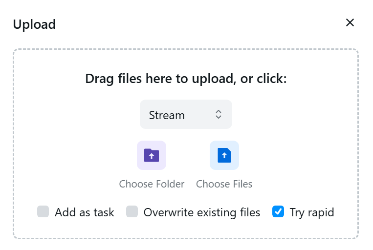

*OpenList's upload dialog — upstream screenshot from the OpenList project documentation (OpenList-Docs, `public/img/config/side/upload-modal-en.png`), showing Stream upload, folder/file pickers, and task options. The live file-browser UI was verified rendering during end-to-end testing of this template's own deployment.*

# Deploy and Host

OpenList is a self-hosted file list and file manager: one web interface in front of local disk, S3 buckets, SFTP and SMB shares, WebDAV servers, and dozens of cloud drives. It is the community-run AGPL-3.0 fork of AList, actively developed after AList's mid-2025 sale. One-click deploy creates a single OpenList service with a persistent volume and no companion database: users, storages, and settings live in an embedded SQLite file on the volume. After deploy, sign in as `admin` with the generated password from your project's variables; the `Files` Local storage is pre-created on the volume, so the first upload works with no storage setup. The built-in `guest` account ships disabled, so anonymous visitors see nothing.

## About Hosting

Hosting OpenList on Railway keeps your files on your own volume and your own storage accounts instead of a third-party file host. The deployment is a single always-on Go service: the wrapper maps Railway's injected `PORT` onto OpenList's HTTP port on every boot, runs as root so the root-owned Railway volume is writable (the stock image refuses to start otherwise — the reason both existing marketplace OpenList templates sit at 0% health), seeds the `admin` account exactly once per volume from the generated password, and pre-creates the `Files` storage. The only deploy-form field is the generated admin password.

## Why Deploy

- Browse many backends from one UI: local disk, S3, SFTP, SMB, WebDAV, Google Drive, OneDrive, Dropbox, and dozens more, each mounted at a path you choose.
- WebDAV server at `/dav` with the same login — mount your files in Finder, Explorer, or any WebDAV client.
- Local files on the volume: upload straight into the pre-created `Files` storage, no cloud account needed.
- Previews in the browser for images, video, audio, and text, plus password-protected paths per folder.
- No database service to run: one always-on Go service with an embedded SQLite file on a persistent volume.
- Self-hosted data: your files stay on your Railway volume and your own storage accounts.

## Common Use Cases

- A single front door for scattered storage: one bucket, one Drive account, and local files behind one login.
- Family or team file sharing over WebDAV without handing out cloud-drive credentials.
- A private upload drop on the volume for files you want off third-party hosts.
- Browse a cloud drive from a phone or a second machine through the web UI instead of vendor apps.

## Dependencies for

- A single OpenList service (Go, embedded SQLite, no companion service).
- One persistent volume mounted at `/opt/openlist/data` (`config.json`, `data.db`, and the `files/` local storage root).
- Environment variables (condensed reference — full documentation in the repo README):

| Variable | Default | Description |
| --- | --- | --- |
| `ADMIN_PASSWORD` | generated | Password for the `admin` account; seeded exactly once per volume on first boot. |
| `PORT` | Railway-injected | OpenList's HTTP port, mapped by the wrapper on every boot (upstream default 5244). |
| WebDAV | `/dav` | Built-in WebDAV server on the same port, same login. |
| S3 / FTP / SFTP servers | off | Upstream defaults; Railway's public edge is HTTP-only, so they stay off here. |
| Offline download | not included | Needs aria2, which the standard upstream image does not bundle. |

### Deployment Dependencies

- Plan tier: works on Railway's entry tiers; a single always-on service with a persistent volume.
- RAM needs: light — one Go service, typically well under 256 MB at rest, no companion database or cache service.
